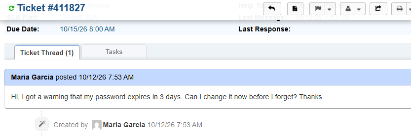
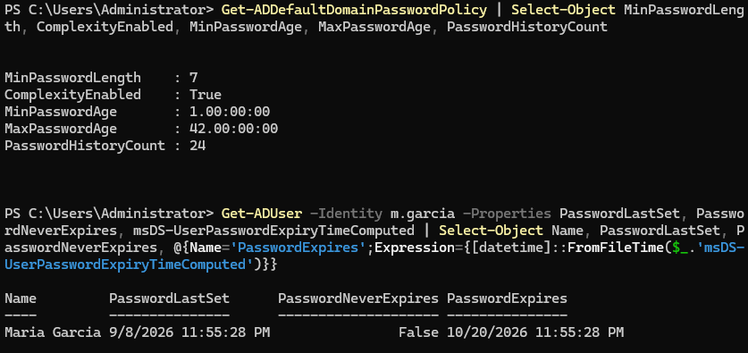
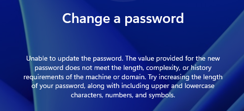
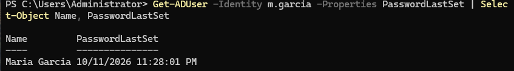
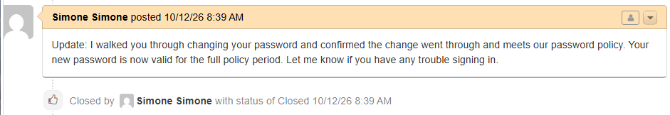

# Ticket 012 — Proactive Password Expiration Request

**Category:** Password/Account
**Priority:** Low
**SLA:** Default
**Requester:** Maria Garcia (ENDUSER01)
**Status:** Resolved

---

## Reported issue

Maria Garcia received a warning that her password would expire in 3 days and asked to change it now, before she forgot.

> "Hi, I got a warning that my password expires in 3 days. Can I change it now before I forget? Thanks, Maria"

## Diagnostic steps

1. Verified the requester's identity by matching the name and department in the ticket against the AD record for m.garcia.
2. Checked the domain password policy on DC01 (`Get-ADDefaultDomainPasswordPolicy`) for minimum length, complexity, minimum and maximum password age, and password history, so the user could be told what a new password must meet.
3. Checked the account's password state (`Get-ADUser -Properties PasswordLastSet, PasswordNeverExpires, msDS-UserPasswordExpiryTimeComputed`) to see when the password was last set and when it expires.

## Resolution

1. Walked the user through changing her own password on ENDUSER01 through the Windows change-password screen.
2. Tried a deliberately weak password first to confirm the complexity policy is actually enforced. Windows rejected it.
3. Set a new password that met the policy. Windows confirmed the change.
4. Verified on DC01 that the change registered in Active Directory:

```powershell
Get-ADUser -Identity m.garcia -Properties PasswordLastSet | Select-Object Name, PasswordLastSet
```

5. Replied to the end user and closed the ticket once she confirmed.

## Notes

- **The "3 days" timeframe was the user's report and was not simulated in the lab.** The account's expiry data was checked in AD to confirm its real state rather than to validate the warning.
- **Not every ticket is a fire.** A proactive request like this is low priority, but it is still worth confirming end to end: the policy, the change itself, and the AD record updating.
- **The policy was tested, not assumed.** Trying a weak password first shows the complexity rules being enforced.

## Screenshots

| Step | Screenshot |
|---|---|
| Ticket submitted | `ticket012-01-ticket-submitted.png` |
| Password policy and expiry checked | `ticket012-02-policy-and-expiry.png` |
| Weak password rejected | `ticket012-03-weak-password-rejected.png` |
| Password changed | `ticket012-04-password-changed.png` |
| PasswordLastSet updated in AD | `ticket012-05-passwordlastset-updated.png` |
| Ticket closed | `ticket012-06-ticket-closed.png` |







