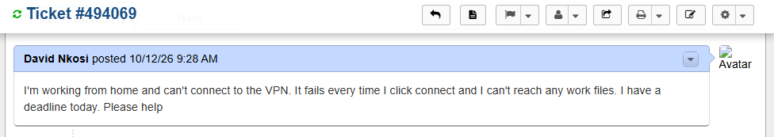
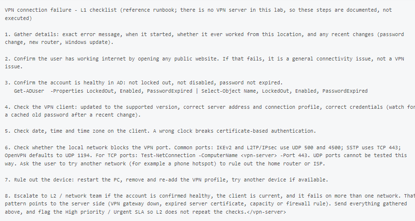
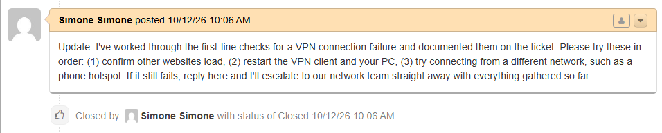

# Ticket 013 — VPN Connection Failure

**Category:** Network
**Priority:** High
**SLA:** Urgent
**Requester:** David Nkosi (remote user)
**Status:** Resolved

---

## Reported issue

David Nkosi reported he could not connect to the VPN while working from home and could not reach any work files. He had a deadline that day.

> "I'm working from home and can't connect to the VPN. It fails every time I click connect and I can't reach any work files. I have a deadline today. Please help."

## Diagnostic steps

Documented the standard L1 checklist for a VPN connection failure, in order from least to most invasive, rather than running live diagnostics. See **Lab limitation** below.

1. Asked the user for the exact error message, whether it had worked from this location before, and any recent changes. He replied that it just says the connection failed, it worked last week, and he had changed nothing that he knew of.
2. Confirm the user has working internet by opening any public website. If that fails, it is a general connectivity issue, not a VPN issue.
3. Confirm the account is healthy in AD: not locked out, not disabled, password not expired (`Get-ADUser <username> -Properties LockedOut, Enabled, PasswordExpired`).
4. Check the VPN client: supported version, correct server address and connection profile, correct credentials (watching for a cached old password after a recent change).
5. Check the client's date, time and time zone, since a wrong clock breaks certificate-based authentication.
6. Check whether the local network blocks the VPN port. IKEv2 and L2TP/IPsec use UDP 500 and 4500, SSTP uses TCP 443, and OpenVPN defaults to UDP 1194. TCP ports can be tested with `Test-NetConnection -ComputerName <vpn-server> -Port 443`. Ask the user to try another network, such as a phone hotspot, to rule out the home router or ISP.
7. Rule out the device: restart the PC, remove and re-add the VPN profile, try another device if available.
8. Escalate to L2 or the network team if the account is healthy, the client is current, and the connection fails on more than one network. That pattern points to the server side (gateway down, expired server certificate, capacity or a firewall rule).

## Resolution

Replied to the user with the first-line steps to try in order: confirm other websites load, restart the VPN client and the PC, and try a different network such as a phone hotspot. Asked him to reply if it still failed so the ticket could be escalated straight away with everything gathered.

## Notes

- **Lab limitation:** there is no VPN server in this lab, so this ticket could not be reproduced live. The checklist is standard L1 reference knowledge, documented as a runbook rather than presented as a tested fix.
- **Escalation criterion included deliberately:** the checklist says exactly when this moves beyond L1 scope (healthy account, current client, failure on more than one network) and what to hand over, so L2 does not repeat the same checks.
- **Priority:** the user was blocked from working, so the ticket was handled as High priority with the Urgent SLA plan.

## Screenshots

| Step | Screenshot |
|---|---|
| Ticket submitted (priority and SLA) | `ticket013-01-ticket-submitted.png` |
| Runbook documented (internal note) | `ticket013-02-runbook-note.png` |
| Ticket closed | `ticket013-03-ticket-closed.png` |

