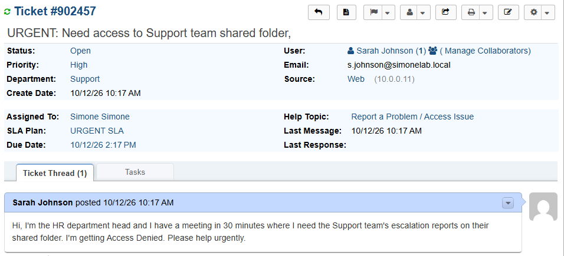
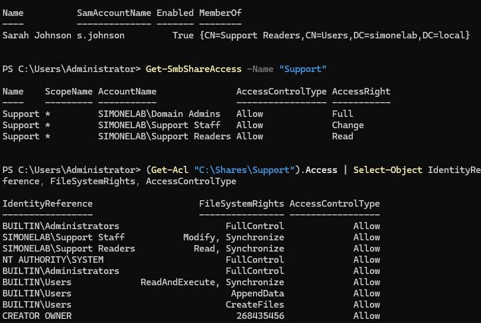
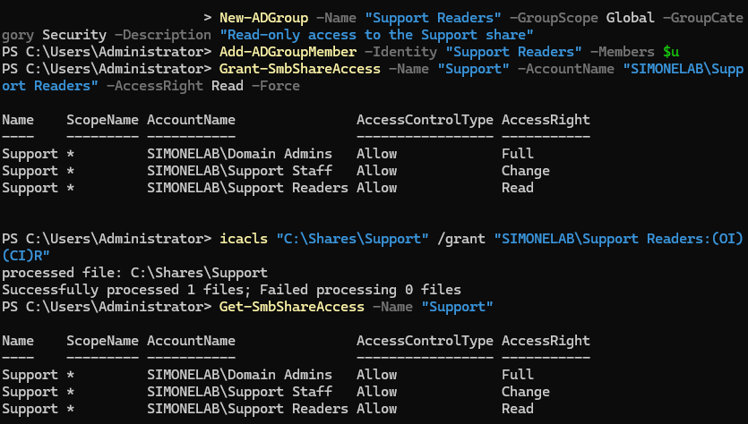
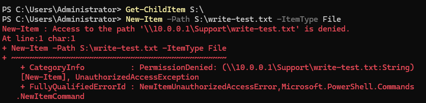
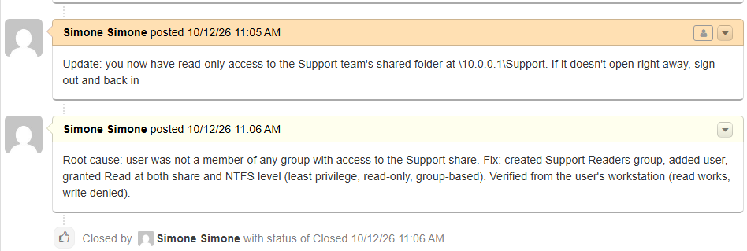

# Ticket 014 — Urgent: Executive Can't Access Critical System

**Category:** Access/Permissions
**Priority:** High
**SLA:** Urgent
**Requester:** Sarah Johnson (HR)
**Status:** Resolved

---

## Reported issue

Sarah Johnson, the HR department head, needed the Support team's escalation reports on their shared folder for a meeting in 30 minutes and was getting "Access Denied".

> "Hi, I'm the HR department head and I have a meeting in 30 minutes where I need the Support team's escalation reports on their shared folder. I'm getting Access Denied. Please help urgently."

## Diagnostic steps

1. Logged the ticket under the Access Issue help topic with High priority and checked the SLA plan and due date on the ticket. Acknowledged it to the user immediately.
2. On DC01, looked up the user's account and group memberships (`Get-ADUser -Properties MemberOf`).
3. Reviewed the share-level permissions (`Get-SmbShareAccess -Name "Support"`) and the NTFS permissions (`Get-Acl "C:\Shares\Support"`) on the Support folder.
4. Finding: the user was not a member of any group with access at either permission layer.

## Resolution

Created a dedicated read-only group, added the user to it, and granted Read at both the share level and the NTFS level:

```powershell
New-ADGroup -Name "Support Readers" -GroupScope Global -GroupCategory Security -Description "Read-only access to the Support share"
Add-ADGroupMember -Identity "Support Readers" -Members $u
Grant-SmbShareAccess -Name "Support" -AccountName "SIMONELAB\Support Readers" -AccessRight Read -Force
icacls "C:\Shares\Support" /grant "SIMONELAB\Support Readers:(OI)(CI)R"
```

Verified from ENDUSER01 using the user's own credentials: listing the share worked, and an attempt to write a file was denied, confirming read-only access and nothing more. Replied to the user, confirmed, and closed the ticket.

## Notes

- **Least privilege:** she only needed to view reports, so she was given read-only access through a new group rather than being added to Support Staff (which has Modify) or given an individual permission.
- **Both permission layers were set deliberately.** Share-level and NTFS permissions both have to allow access, the lesson from Ticket 004.
- **Urgent handling:** acknowledged immediately and worked the fix in PowerShell to keep it quick. The created and resolved times are visible in the closing screenshot.
- **Recommended follow-up:** an access review once the need for the reports ends.

## Screenshots

| Step | Screenshot |
|---|---|
| Ticket submitted (priority, SLA, due date) | `ticket014-01-ticket-submitted.png` |
| Diagnosis on DC01 | `ticket014-02-diagnosis.png` |
| Access granted | `ticket014-03-access-granted.png` |
| Verified from the user's side | `ticket014-04-verified.png` |
| Ticket closed (created and resolved times) | `ticket014-05-ticket-closed.png` |






