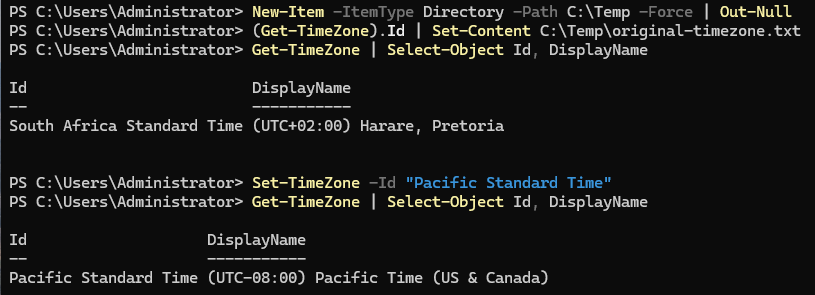
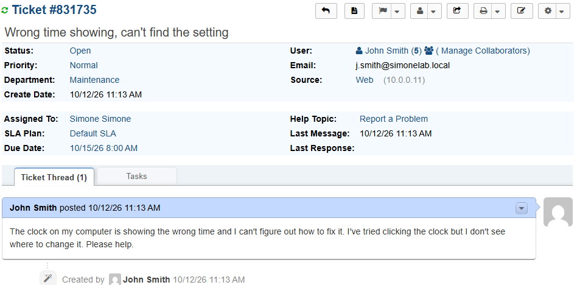
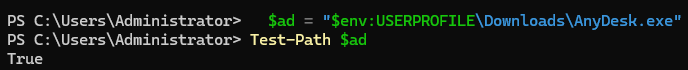
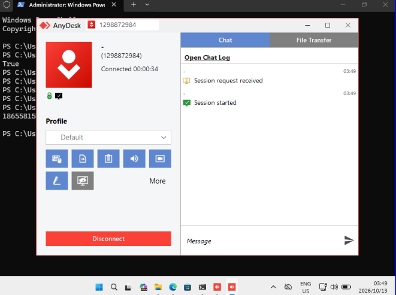
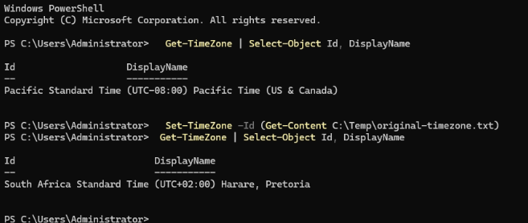
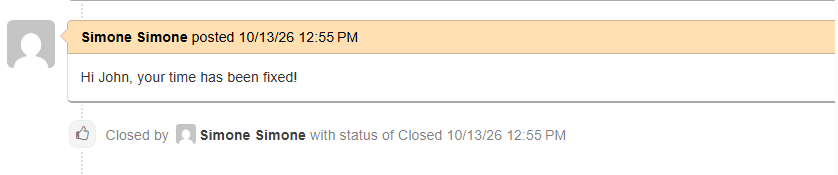

# Ticket 015 — Remote Troubleshooting via AnyDesk

**Category:** Remote Support
**Priority:** Normal
**SLA:** Default
**Requester:** John Smith (ENDUSER01)
**Status:** Resolved

---

## Reported issue

John Smith reported that his computer's clock showed the wrong time and he could not find where to change it.

> "The clock on my computer is showing the wrong time and I can't figure out how to fix it. I've tried clicking the clock but I don't see where to change it. Please help."

## Diagnostic steps

1. Reviewed the request. Because this was a settings step the user could not locate, a remote session was the fastest way to fix it. Replied asking the user to click Accept when the connection request appeared.
2. Got AnyDesk running on both ENDUSER01 and HELPDESK01, then started it on ENDUSER01 and read its address with the command-line option `--get-id`.
3. Connected from HELPDESK01 using that address. The user accepted the request on ENDUSER01. Unattended access was not enabled.
4. Inside the session, checked the time zone with `Get-TimeZone`. It was set to Pacific Standard Time instead of South Africa Standard Time.

## Resolution

Restored the correct time zone from inside the remote session and verified it:

```powershell
Set-TimeZone -Id (Get-Content C:\Temp\original-timezone.txt)
Get-TimeZone | Select-Object Id, DisplayName
```

The check showed South Africa Standard Time (UTC+02:00) again. Ended the remote session by closing AnyDesk, then confirmed with the user that the clock was correct.

## Notes

- **How AnyDesk was run:** installing it with winget failed (error `0x8a15006d`), and a command-line download was blocked by AnyDesk's website, which serves a browser check. The installer was downloaded in a browser on each VM and run directly from the download, without installing it. The free (non-professional) licence was used, for lab purposes only.
- **Consent and access control:** the user was told a connection was coming and accepted it explicitly. Unattended access was left off, and the session was ended as soon as the fix was verified.
- **Test setup:** the wrong time zone was introduced deliberately to give the session a real setup step to complete. The original time zone was saved to a file first and restored from it, so the fix did not rely on remembering the value.

## Screenshots

| Step | Screenshot |
|---|---|
| Fault planted (time zone changed) | `ticket015-01-fault-planted.png` |
| Ticket submitted | `ticket015-02-ticket-submitted.png` |
| AnyDesk ready on ENDUSER01 (path check and address) | `ticket015-03-anydesk-installed.png` |
| Remote session active | `ticket015-04-remote-session-active.png` |
| Time zone fixed inside the session | `ticket015-05-fix-applied.png` |
| Ticket closed | `ticket015-06-ticket-closed.png` |







